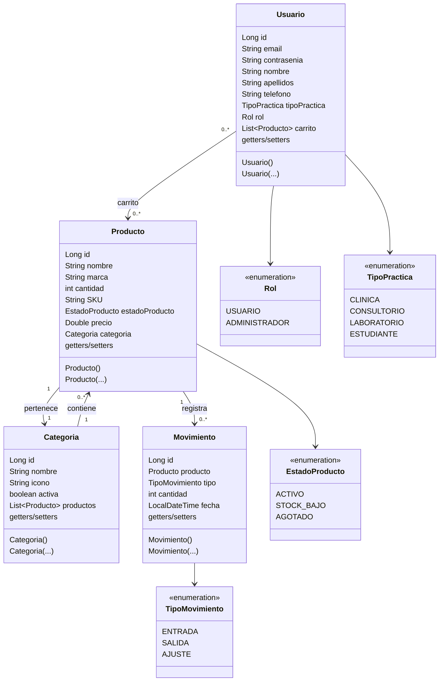
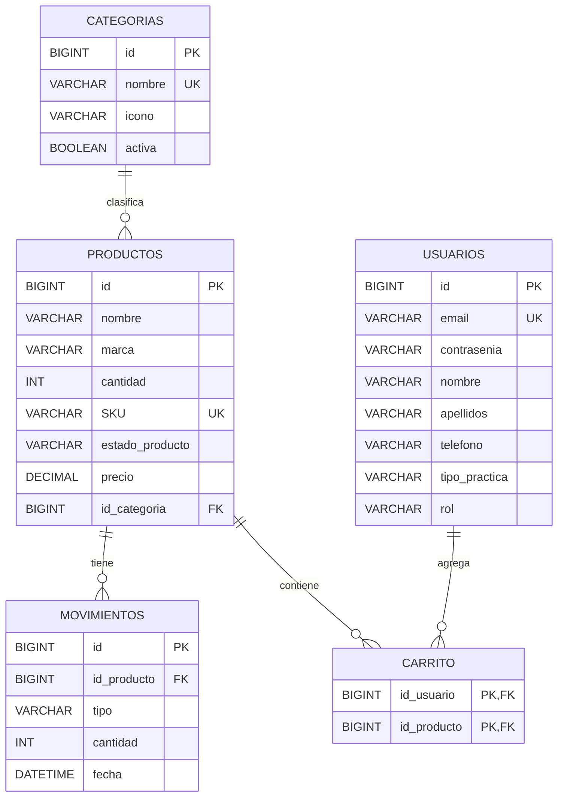

# Modelo de datos y definición de dominio

## Elección de base de datos

Dentmarc utiliza una base de datos **SQL relacional**, específicamente MySQL en
el entorno de ejecución. La información del sistema tiene una estructura
definida y varias relaciones que deben conservar integridad:

- cada producto pertenece a una categoría;
- cada movimiento de inventario corresponde a un producto;
- un usuario puede tener varios productos en su carrito y un producto puede
  estar en los carritos de varios usuarios;
- el correo del usuario y el SKU del producto son valores únicos.

El modelo relacional permite expresar estas relaciones mediante claves
primarias, claves foráneas, restricciones `NOT NULL` y restricciones de
unicidad. Además, JPA/Hibernate permite consultar y administrar estas
entidades mediante repositorios Spring Data JPA. NoSQL no es necesario en este
caso porque los datos no son principalmente documentos variables ni requieren
desnormalización para su operación principal.

## Diagrama UML de clases

El siguiente diagrama representa las entidades implementadas en
`src/main/java/com/example/Dentmarc/models` y sus asociaciones principales.

Las clases del diagrama corresponden al código Java:

- [Repositorio GitHub de Dentmarc](https://github.com/isa1ascm/Dentmarc)
- [Rama `feat-administracion`](https://github.com/isa1ascm/Dentmarc/tree/feat-administracion)
- [Usuario.java](../src/main/java/com/example/Dentmarc/models/Usuario.java)
- [Categoria.java](../src/main/java/com/example/Dentmarc/models/Categoria.java)
- [Producto.java](../src/main/java/com/example/Dentmarc/models/Producto.java)
- [Movimiento.java](../src/main/java/com/example/Dentmarc/models/Movimiento.java)
- [Rol.java](../src/main/java/com/example/Dentmarc/models/enums/Rol.java)
- [TipoPractica.java](../src/main/java/com/example/Dentmarc/models/enums/TipoPractica.java)
- [EstadoProducto.java](../src/main/java/com/example/Dentmarc/models/enums/EstadoProducto.java)
- [TipoMovimiento.java](../src/main/java/com/example/Dentmarc/models/enums/TipoMovimiento.java)

Lombok genera los métodos de acceso y los constructores indicados por
`@Data`, `@NoArgsConstructor` y `@AllArgsConstructor`. Las asociaciones se
implementan con `@ManyToOne`, `@OneToMany` y `@ManyToMany`.

## Modelo entidad-relación

## Persistencia

Las interfaces de acceso a datos se encuentran en
`src/main/java/com/example/Dentmarc/repository` y extienden
`JpaRepository`:

- [UsuarioRepository.java](../src/main/java/com/example/Dentmarc/repository/UsuarioRepository.java)
- [CategoriaRepository.java](../src/main/java/com/example/Dentmarc/repository/CategoriaRepository.java)
- [ProductoRepository.java](../src/main/java/com/example/Dentmarc/repository/ProductoRepository.java)
- [MovimientoRepository.java](../src/main/java/com/example/Dentmarc/repository/MovimientoRepository.java)

La lógica de negocio está en los servicios y los controladores solo coordinan
las solicitudes web y el patrón POST/Redirect/GET.
