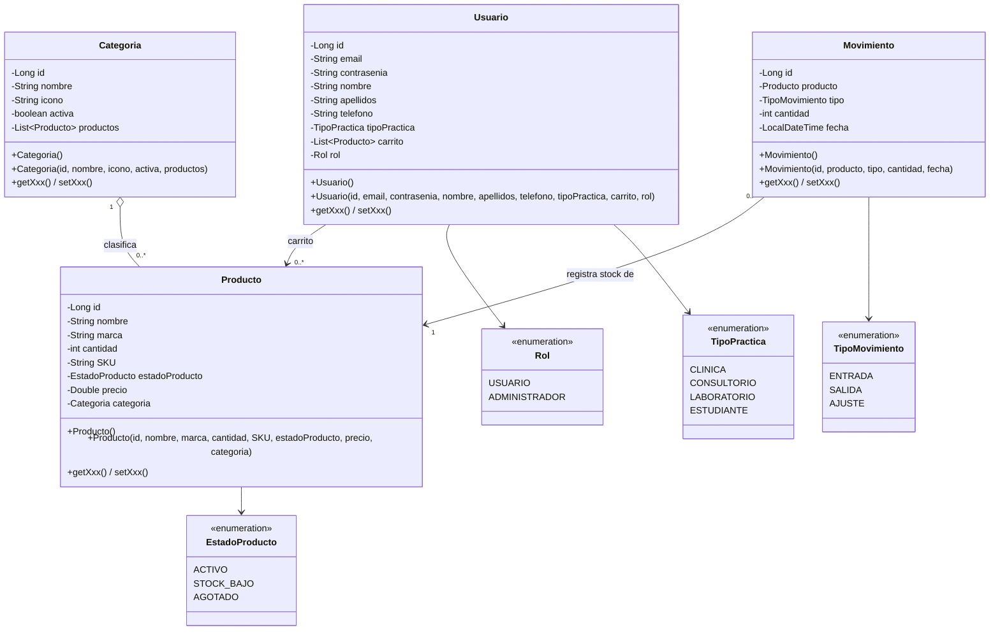
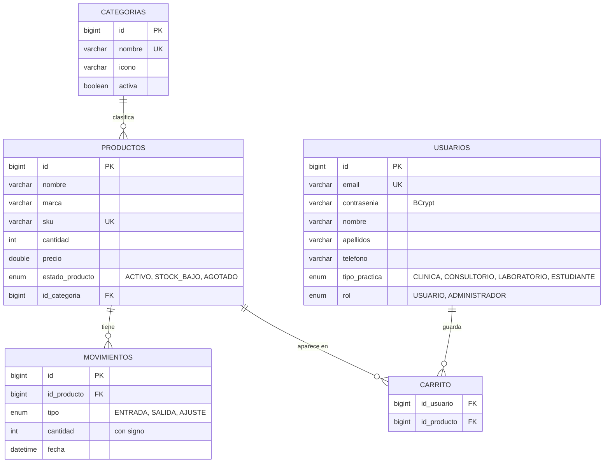

# Dentmarc · Avance 02 — Modelo de datos y dominio

> Los diagramas están escritos en [Mermaid](https://mermaid.js.org/), así que GitHub los dibuja directamente al abrir este archivo.

## Parte 1 · Elección de base de datos

**Se eligió una base de datos SQL (MySQL).**

La información de Dentmarc es estructurada y está muy relacionada entre sí:

- Cada **producto** pertenece a exactamente una **categoría** (relación 1 a N).
- Cada **movimiento de inventario** pertenece a un producto (1 a N) y es el historial que explica por qué cambió el stock.
- Un **usuario** guarda productos en su **carrito** y un producto puede estar en el carrito de muchos usuarios (N a M).
- Los datos de cada entidad tienen siempre los mismos campos (nombre, SKU, precio, cantidad…), por lo que un esquema fijo es una ventaja y no una limitación.

Razones concretas para preferir SQL frente a NoSQL:

1. **Integridad referencial:** las llaves foráneas impiden, por ejemplo, borrar una categoría que todavía tiene productos o registrar un movimiento de un producto que no existe.
2. **Transacciones (ACID):** registrar un movimiento actualiza el stock del producto *y* guarda el movimiento; ambas operaciones deben ocurrir juntas o ninguna. El mismo principio aplicará a los pedidos en los siguientes avances.
3. **Consultas y reportes:** el panel necesita conteos, sumas y filtros (productos por estado, unidades totales, valor del inventario), que SQL resuelve de forma natural.
4. **Integración con el stack:** Spring Data JPA + Hibernate generan el esquema a partir de las entidades (`ddl-auto=update`), y MySQL es el motor que ya se usa en el curso.

Un modelo de documentos (NoSQL) tendría sentido si cada producto tuviera atributos muy distintos entre sí o si se necesitara escalar escrituras masivas, y ninguno de los dos casos aplica aquí.

## Componente de dominio · Diagrama de clases UML

Las clases Java están en `src/main/java/com/example/Dentmarc/models`. Todas usan Lombok (`@Data`, `@NoArgsConstructor`, `@AllArgsConstructor`), que genera el constructor vacío, el constructor con todos los atributos, y los métodos de acceso (getters y setters) de cada atributo.

## Entregable · Modelo de datos (diagrama entidad–relación)

### Reglas del dominio

- El **estado** de un producto se calcula solo a partir de la cantidad: `0` → `AGOTADO`, `1–20` → `STOCK_BAJO`, más de `20` → `ACTIVO`.
- Un **movimiento** `ENTRADA` suma stock, `SALIDA` lo resta (no puede quedar negativo) y `AJUSTE` deja el stock en la cantidad indicada. La cantidad se guarda con signo para poder mostrar `+24` o `-12`.
- Una **categoría** con productos no se puede eliminar.
- Las **contraseñas** se guardan cifradas con BCrypt; nunca en texto plano.

### Cambios al dominio del primer avance

| Cambio | Motivo |
| --- | --- |
| `CategoriaProducto` (enum) → entidad `Categoria` | El panel debe poder crear, editar, ocultar y eliminar categorías, algo que un enum no permite. |
| `ProductoRepository.findByCategoriaProducto` → `findByCategoria` | La categoría dejó de ser enum, así que la consulta recibe la entidad `Categoria`. |
| `Producto.marca` (nuevo) | El diseño de Figma ya muestra la marca bajo el nombre del producto y permite buscar por ella. |
| `Usuario.carrito` con `@ManyToMany` | `@Column` no puede mapear una lista de entidades; ahora se guarda en la tabla `Carrito`. |
| Enums con `@Enumerated(EnumType.STRING)` | Se guardan como texto legible en la base de datos, no como números. |
| `Movimiento` + enum `TipoMovimiento` (nuevos) | Historial del módulo de inventario. |
